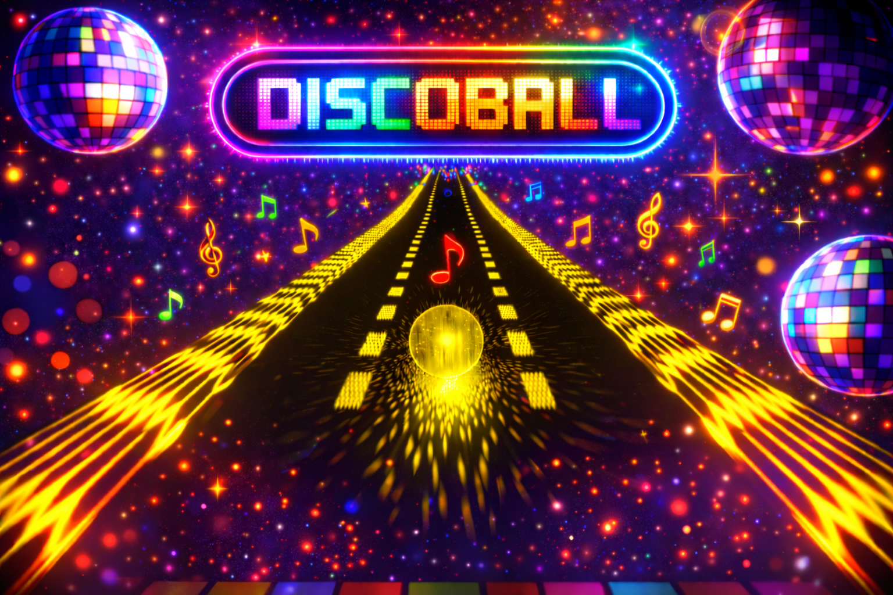

<h1 align="center" style="font-size: 42px; margin-bottom: 10px;">
🪩 DiscoBall 🪩
</h1>

   

   <b>Roll, collect, and survive in this colorful arcade challenge where your disco ball constantly changes color!</b>

## How to run the game

1. Unzip the DiscoBall_Build folder
2. Open the folder DiscoBall_Build
3. Launch RollingBallGame.exe

## Goal

Your disco ball constantly changes color, and you must collect pickups that match your current color to gain points. Collecting the wrong color will reduce your health!

As your score increases, the speed of the ball increases too, making the game progressively harder, so try to survive as long as possible to reach the highest score.

Various bonuses will help you survive longer and increase your chances of getting a high score :
- **Shield** : Protects you from wrong-color pickups for 5 seconds.
- **Magnet** : Attracts pickups matching your current color for 5 seconds
- **×2 Multiplier** : Doubles the points gained from pickups for 5 seconds.
- **Heart** : Restores 1 health point.
- **+5 Bonus** : Grants 5 points instantly and can be collected regardless of your current color.

## Controls
The game is mainly designed to be played with a controller, but keyboard controls are also available.

| Action | Controller | Keyboard |
| ---- | ---- | ---- |
| Move Right | Left Thumbstick Right / D-Pad Right | D / Right Arrow |
| Move Left | Left Thumbstick Left / D-Pad Left | A / Left Arrow |
| Jump | Face Button Bottom (A on Xbox) | Space |
| Move Down (while jumping) | Left Thumbstick Down / D-Pad Down  | S / Down Arrow |
| Pause | Right / Left Special Button |  P |
| Change Music | Face Button Top (Y on Xbox) | W |
| Navigate Menus | Left Thumbstick Up / Down | Mouse |

## Credits

This project was created by Katia Kaci as part of the Ubisoft Warm Up Program.

- **Engine:** Unreal Engine 4

- **Assets:** Epic Starter Content, Imaginarium, Sketchfab

- **Images:** ChatGPT, Imaginarium

- **Sounds and Music:** Mixkit, Uppbeat, Pixabay

Enjoy playing! 😀

